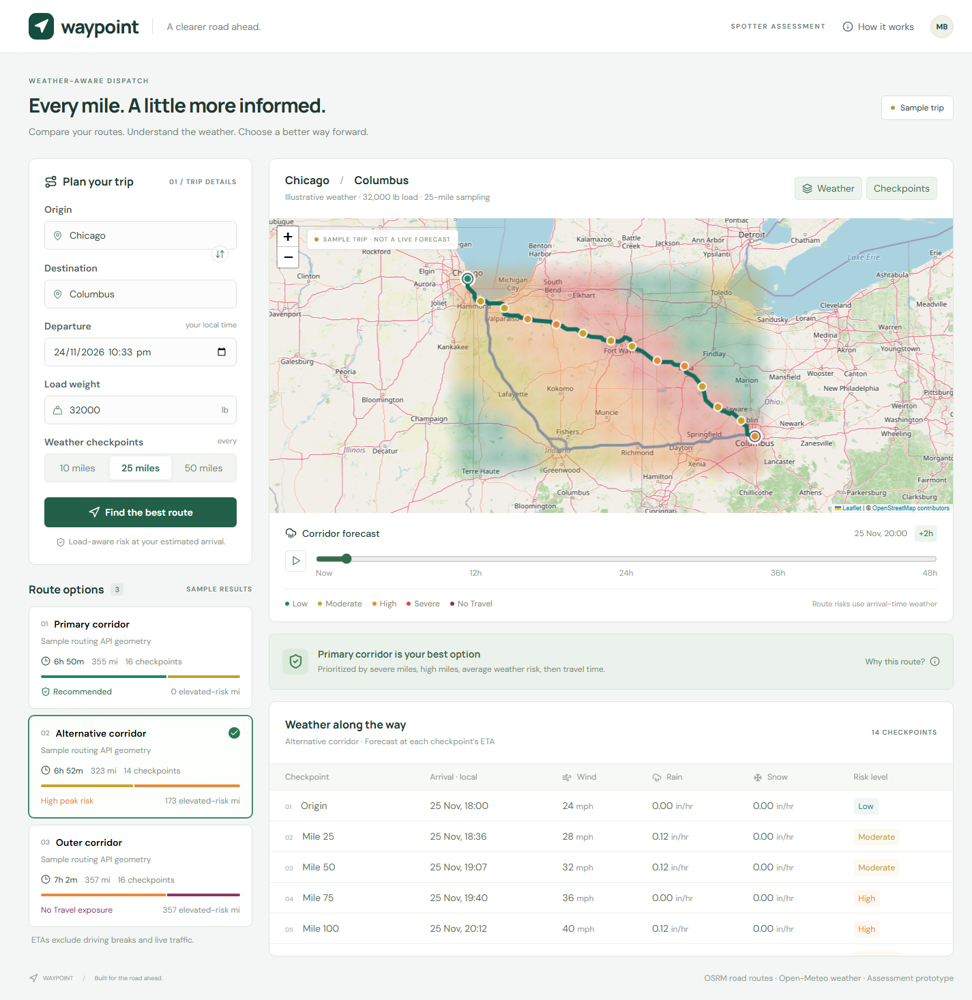

# Waypoint — Weather-aware truck routing

React + TypeScript and Django assessment application. Compare three road routes using forecast weather at each checkpoint's estimated arrival, load-aware risk, and a 48-hour corridor weather overlay.



Local verification: **14 backend tests passing**, production build passing, desktop/mobile browser checks passing, and live trip submission verified. See [verification details](docs/VALIDATION.md) for results and outstanding deployment steps.

## Run locally

Requires Python 3.11+ and Node.js 22+.

```powershell
python -m venv .venv
.venv/Scripts/python -m pip install -r backend/requirements.txt
.venv/Scripts/python backend/manage.py runserver
```

In another terminal:

```powershell
cd frontend
npm ci
npm run dev
```

Open http://127.0.0.1:5173. Vite proxies `/api` to Django on port 8000. No API keys or database are required. On macOS/Linux, use `.venv/bin/python` instead.

The initial view is an explicitly labeled sample trip with real OSRM road geometry and **synthetic weather**. Click **Find the best route** for live calculations. Sample weather does not change when form inputs change; live results update only after submitting the form. A failed live request preserves prior results and shows an error; it never silently substitutes sample data.

## Architecture

```text
React form + Leaflet map
        │ POST /api/plan/
        ▼
Django validation → city geocoding → OSRM alternatives
        → distance checkpoints + edge-duration ETAs
        → batched hourly weather → risk + segment exposure
        → lexicographic recommendation + corridor forecast
```

- `backend/routing/risk.py`: pure threshold, exposure, and ranking functions.
- `backend/routing/service.py`: providers and forecast matching.
- `backend/routing/geometry.py`: pure geometry sampling and edge-duration ETAs.
- `backend/routing/views.py`: bounded inputs and useful error responses.
- `frontend/src/TripMap.tsx`: map layers, selection, checkpoint details.
- `frontend/src/main.tsx`: trip inputs, route comparison, forecast playback, results.
- `frontend/src/sample.json`: repeatable demonstration fixture.

## Calculation rules

Wind bands start at 25, 35, 45, and 55 mph. Rain bands start at 0.10, 0.25, and 0.50 in/hr; No Travel starts strictly above 1.00. Snow bands start at 0.5, 1.0, and 2.0 in/hr; No Travel starts strictly above 3.0. The PDF overlaps some boundaries; exact shared values use the higher risk band, except its explicit strict No Travel limits.

At each checkpoint, the worst of wind/rain/snow determines the score (0–4). Load overrides follow the assessment exactly: wind ≥55 means No Travel for all loads; wind ≥45 and load >30,000 lb means No Travel; wind ≥35 and load >40,000 lb means at least Severe.

Checkpoints include the origin, every selected 10/25/50 miles, and the destination. Geometry distances are normalized to provider route mileage. ETAs integrate OSRM edge-duration annotations, rather than assigning one constant speed to the entire journey. Each checkpoint uses the UTC forecast hour containing its ETA. Snowfall units are read from provider metadata; centimeters are converted to inches only when needed. Rain includes both rain and showers.

Each segment receives the worse risk of its endpoints. Exposure miles therefore sum to route distance, and average risk is distance weighted. Routes with any No Travel exposure are excluded. Remaining routes are ranked by `(Severe miles, High miles, average risk, travel seconds)`, in that exact order. If all routes are blocked, no recommendation is issued.

The weather overlay is a coarse grid of forecast risk, not radar. It uses current hour +0…48, while checkpoint risk always uses the trip's arrival times. Forecast playback uses cached response data and makes no requests. Provider responses are cached for 10 minutes per server process; weather locations are batched in groups of 40.

## Provider limits and tradeoffs

- OSRM may return fewer than three alternatives. The backend requests additional routes through corridor waypoints and labels them. If three distinct routes are unavailable, it reports a failure instead of duplicating routes.
- The public OSRM profile is general driving, **not truck-certified routing**. Height/weight/bridge restrictions, live traffic, breaks, and hours of service are outside this assessment.
- City search currently selects the first geocoding match. Verify the resolved place names in the map endpoint popups before interpreting a result. An explicit disambiguation selector is the next improvement.
- Forecasts are hourly. Departure is limited to five days ahead, routes to 2,500 miles, and loads to 80,000 lb. Missing/out-of-horizon forecasts stop calculation.
- Public providers and map tiles require network access and may throttle requests. This is an assessment prototype, not a production dispatch system.
- Free-form load is cargo weight, as described by the assignment; it does not certify a legal gross vehicle weight.

Provider references: [OSRM](https://project-osrm.org/docs/v5.24.0/api/), [Open-Meteo forecast](https://open-meteo.com/en/docs), [Open-Meteo geocoding](https://open-meteo.com/en/docs/geocoding-api). Map tiles: OpenStreetMap with in-map attribution. Follow the [tile usage policy](https://operations.osmfoundation.org/policies/tiles/); no tile prefetching or offline downloads are implemented.

## Checks

```powershell
.venv/Scripts/python backend/manage.py test routing
.venv/Scripts/python backend/manage.py check
cd frontend
npm run build
```

Tests cover threshold edges, strict load cutoffs, worst-condition aggregation, distance conservation, recommendation priorities, route sampling, forecast conversion/horizon, input rejection, and upstream failure handling.

## Deploy

Use Vercel for the React app and Render for Django. The repository includes `render.yaml` and `frontend/vercel.json`.

1. Push this repository to GitHub.
2. In Render, create a Blueprint from the repository, or a Python web service with root directory `backend`. Build: `pip install -r requirements.txt`. Start: `gunicorn config.wsgi:application --bind 0.0.0.0:$PORT --workers 2 --threads 4 --timeout 180`.
3. Set `DJANGO_DEBUG=false`, a random `DJANGO_SECRET_KEY`, `DJANGO_ALLOWED_HOSTS` to your backend hostname (no scheme), and `CORS_ALLOWED_ORIGINS` to your exact frontend URL (including `https://`). Comma-separate multiple hosts/origins. The app reads environment variables directly; it does not automatically load `.env` files.
4. Import the repository in Vercel. Set root directory to `frontend`, framework to Vite, and `VITE_API_BASE_URL` to the Render URL without a trailing slash. Redeploy after changing this build-time variable.
5. Confirm backend `/api/health/` returns `{"status":"ok"}`, then calculate a live trip on the deployed frontend. Confirm CORS and map tiles work. A frontend sample alone is not proof the live backend works.

See `.env.example` for variable names. Never commit secrets. See `docs/WALKTHROUGH.md` for the recording outline and `docs/PLAN.md` for the assessment-focused delivery plan.
